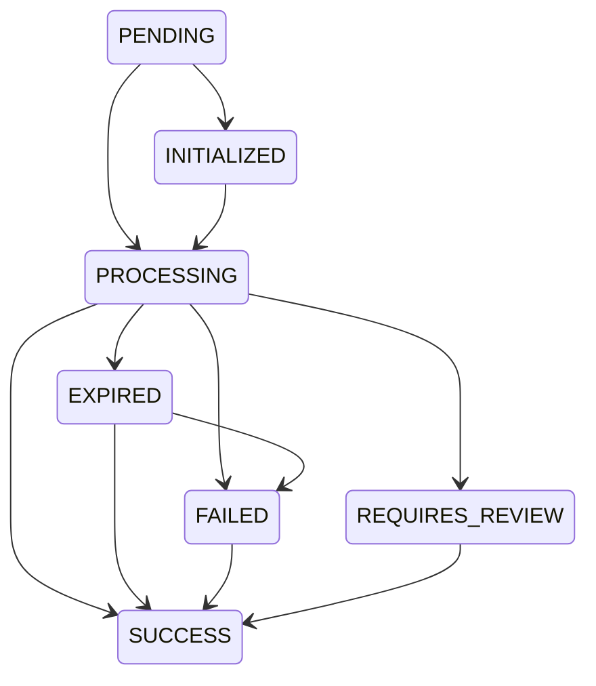

# Checkout hardening audit and rollout

This change preserves NestJS, Firestore, Paystack InlineJS, integer ZAR prices,
the existing shipping calculation, and the existing initialize/verify responses.
It adds account recovery, a separate payment record, durable jobs, and stricter
verification. Automated tests use isolated database adapters and mocked provider
responses; they do not demonstrate a live Paystack payment.

## Findings

| Severity | Finding and customer impact | Implementation |
| --- | --- | --- |
| High | Guest-cookie-only ownership could not recover an order after cookie loss or on another device. | New checkout requires existing CheFu authentication; account recovery/history and proof-based legacy claiming. |
| High | Changing the idempotency key could create multiple payable sessions; the frontend lost keys on restart. | Atomic account active-checkout pointer, canonical request fingerprint, scoped key records, explicit terminal-order acknowledgment. |
| High | Initialization could be submitted again after its lease expired despite an uncertain previous response. | Persist dispatch intent before the one provider POST; never automatically repeat initialization. |
| High | Provider transaction IDs were not validated or uniquely registered; mode and attempt association were not checked. | Atomic provider-ID registry, exact 64-bit identity handling, immutable order/attempt/amount/currency/customer/mode verification. |
| High | Webhook processing had no durable inbox or failed-job recovery. | Signed minimal event summaries, deduplication, durable leased jobs, retries and dead letters. |
| High | Reconciliation used process-local exclusion and omitted failed/expired cases. | Firestore job leases plus per-payment verification leases, bounded retry policy and late-success handling. |
| High | Fly could stop every machine when browsers left, stopping reconciliation. | Keep one machine running in `fly.toml`; deployment changes infrastructure cost. |
| High | An administrator's product save could overwrite an inventory reservation committed after the product read. | Firestore update-time precondition; conflicting save returns 409. |
| Medium | Payment lifecycle and business order state shared one field. | Separate `storePayments` state machine with monotonic success; legacy order status remains a compatibility projection. |
| Medium | Fulfillment had a queue entry but no durable delivery/retry worker. | Leased fulfillment jobs, stable receiver idempotency key, validated acknowledgment and audited completion. |
| Medium | Provider failures all became generic errors; reads had no bounded retries. | Distinguish timeout, unavailable, rate-limited, not-found, invalid response, mismatch and verified outcomes; retry GET only. |
| Medium | Generic 4 MB parsing and IP-only throttling were too broad for checkout. | 64 KB webhook/32 KB checkout parsing, DTOs, per-account quotas, active-order limit, per-IP limits, coalesced verification. |
| Medium | Checkout configuration was only checked on use. | Startup validation of mode/key pairing, HTTPS backend, distributed limits and optional fulfillment receiver. |
| Medium | No payment audit, mismatch alert or dead-letter inspection endpoint. | Structured events, audit records, persisted operational alerts and protected admin retry/alert endpoints. |
| Low | Browser recovery depended on tab storage and was saved only when opening Paystack. | Restore from the authenticated backend before another checkout; save local reference immediately after initialization. |

No direct signature bypass or browser-controlled paid transition was demonstrated
in the previous code. The highest discovered risks were duplicate payable
sessions, unrecoverable customer state, and incomplete background operations.

## Data and state model

`storeOrders/{reference}` remains the business order and owns authoritative price,
delivery, stock allocation, and account UID. Its compatibility `status` is
`initializing`, `pending`, `paid`, or `failed`. Fulfillment status is independent.

`storePayments/{reference}` is the associated payment attempt. There is currently
one provider attempt per business order; a retry after an explicitly acknowledged
terminal outcome creates a new order. Provider reference equals the existing
order reference, preserving client compatibility.

The code also allows independently verified success/failure directly from
PENDING/INITIALIZED, and review from any unresolved state. SUCCESS is absorbing:
a stale response cannot downgrade it. FAILED cannot return to INITIALIZED or
PROCESSING. Local expiry is 30 minutes and hides the resume control; it does not
cancel a provider transaction, release stock, or prevent a late verified success.
Uncertain, expired and mismatched payments keep their stock allocation and block
another account checkout until resolved. Definitive provider failure releases
stock once. Late success reacquires released stock or creates a stock-review hold.

Refund execution and cancellation APIs did not exist and are not introduced.
Refund/dispute notifications have separate durable event/audit/review records;
they never erase payment success or infer refunded balances. Duplicate refund,
partial-refund balance, and refund execution tests are therefore not applicable
to this integration. Staff continue using the provider's authorized dashboard.
Do not enable an automated refund API without its own balance and idempotency model.

Additional collections: `storeCheckoutAccounts`, `storeCheckoutKeys`,
`storeProviderTransactions`, `storeWebhookEvents`, `storeJobs`,
`storeFulfillments`, `storePaymentAudit`, `storeAlerts`, `storeMigrationRecords`.
All are server-only. Firestore document IDs provide uniqueness inside transactions.
Do not give browser SDKs write access to these collections. Keep deduplication and
financial records for the organization's required retention period; do not apply
automatic TTL to unresolved payments, stock reservations, or uniqueness records.

## API and account compatibility

New initialize calls require the existing Firebase/OAuth/session authentication.
No new login system is added. The existing frontend JSON request and amount response
are preserved. The client now checks account recovery before creating checkout.

- `POST /store/checkout/initialize`: authenticated, idempotency key required.
- `POST /store/checkout/verify`: authenticated ownership; legacy orders may still
  be accessed with their original HttpOnly checkout cookie.
- `GET /store/checkout/recover`: current account checkout, amounts, purchased item
  identifiers, verified status, and resumable access code when appropriate.
- `GET /store/checkout/orders`: latest 20 orders owned by the signed-in account.
- `POST /store/checkout/acknowledge`: `{reference}`, clears the active account
  pointer only after paid/failed. An unresolved payment cannot be acknowledged.
- `POST /store/checkout/claim-legacy`: authenticated `{reference}` plus the original
  guest cookie; links ownership transactionally. Matching email is never proof.
- `POST /store/checkout/webhook`: signed provider events; no customer login.
- `GET /store/admin/alerts`: unresolved operational alerts, newest 50, admin only.
- `POST /store/admin/retry-job`: `{reference: "job-document-id"}`, admin only,
  audited requeue of a dead/queued job. Running/completed jobs cannot be reset.

Account checkout initialization is limited to 15 calls/15 minutes and 10 newly
created orders per UTC day. Other account checkout endpoints allow 60 calls/15
minutes per operation. IP initialization allows 120 calls/15 minutes so shared
networks are not constrained by one shopper's limit. Existing trusted-proxy
configuration supplies IPs. Actual provider verification is additionally coalesced
by a 45-second lease and a 10-second successful-verification cooldown.

Old clients must upgrade to sign in before initializing. Legacy verification is
retained for existing orders. A legacy order whose cookie and reference are both
lost cannot be securely linked automatically: staff must establish ownership.
Do not claim orders solely by email.

## Webhook, reconciliation and fulfillment

Authenticate exact raw bytes before recording anything. Legacy
`x-paystack-signature` uses HMAC-SHA512 and the API secret. Configuring
`PAYSTACK_WEBHOOK_SECRET` selects the timestamped signing-secret format and rejects
legacy fallback. Both use constant-time comparison. No request payload or
authorization header is added to payment logs.

The webhook returns 200 only after the event and its job commit. The raw-body hash
deduplicates replay. Store only event type, reference, provider event ID, and
processing timestamps. Unknown event types are ignored; refund/dispute events are
recorded for review even if their shape does not expose an order reference.

Workers run every 15 seconds, selecting up to 20 due jobs. Each job has a random
lease token and 90-second lease, checked again before completion. Crashed workers'
jobs are reclaimable after expiry. Payment verification also has its own lease,
so webhook/user/reconciliation requests share one provider lookup. Network GETs
retry at most three times within a bounded timeout. POST initialization never
retries. Retry-After cooldowns defer work to the durable queue.

Unresolved jobs use exponential backoff and jitter capped at six hours. After
40 executions or seven days they enter `dead` and create an alert. This is an
operational escalation, not proof of payment failure. Stock and unresolved account
locks remain. Staff investigate the provider reference and requeue through the
admin endpoint; a later signed success event can still settle the order.

Paid confirmation and fulfillment creation share one Firestore transaction.
The optional HTTPS fulfillment receiver gets a stable
`Idempotency-Key: store-fulfill-<reference>` and must durably deduplicate before
shipping/granting anything. It returns `{accepted:true, orderId:"<reference>"}`.
Only then is local fulfillment marked completed (meaning accepted by that
receiver, not delivered to the customer). A lost response retries the same key.
The database alone does not guarantee exactly-once external delivery.

Without a configured receiver, jobs stay pending and eventually alert. Migration
and stock-review holds are never dispatched automatically. Review those records
and inventory before staff authorize fulfillment. Shipment tracking, carrier
integration, receipt delivery, and email sending are not supplied by this change.

## Configuration and rollout

1. Pause new checkout (`STORE_CHECKOUT_ENABLED=false`) while preparing rollout.
   Verification and workers continue using the configured Paystack key.
2. Export/backup the current Firestore commerce collections. Deploy added indexes
   in `firestore.indexes.json` and confirm server-only access rules in the Firebase
   project. This repository does not own the project's deployed security rules.
3. Configure `PAYSTACK_SECRET_KEY`, explicit matching `PAYSTACK_MODE=test|live`,
   `BACKEND_PUBLIC_URL=https://...`, allowed frontend origins, and
   `RUNTIME_LIMIT_STORE=redis|firestore` in production. Keep test/live data and keys
   isolated. Never change the mode of an existing payment dataset to process it
   with another environment's key.
4. Configure the same-mode Paystack dashboard webhook at
   `https://api.chefu.co.za/store/checkout/webhook`. Set `PAYSTACK_WEBHOOK_SECRET`
   only when the dashboard uses that signature format. No redirect marks paid.
5. Run `npm run migrate:store` for a read-only preview, then
   `npm run migrate:store -- --apply`. It pages orders and uses transactions,
   preserves amount/status/stock/ownership, and can be rerun after interruption.
   Legacy paid fulfillment gets a migration review hold to avoid reshipping
   historical orders. Never automatically reinitialize migrated attempts.
6. Deploy backend and upgraded client together. Keep at least one backend machine
   running; `fly.toml` now requests this. Set `STORE_RECONCILIATION_ENABLED=true`.
7. If using automated fulfillment, configure `STORE_FULFILLMENT_URL` and a
   32+ character `STORE_FULFILLMENT_TOKEN`, and verify receiver deduplication.
8. Complete Paystack test-mode browser/webhook scenarios against the deployed
   backend, validate alerts and fulfillment recovery, then enable both backend
   `STORE_CHECKOUT_ENABLED=true` and frontend `NEXT_PUBLIC_CHECKOUT_ENABLED=true`.
   Rebuild the frontend after changing its public environment.

Rollback: pause new checkout, preserve all new financial, event, identity, and job
records, and keep compatible verification/reconciliation workers running. The
migration is additive; it does not require destructive data rollback. Do not run
the old writer alongside v2 or deploy it over v2 orders: it lacks account locking,
identity constraints and job leases. Forward-fix processing or restore a compatible
v2 build; restore a database backup only through the organization's recovery
process after reconciling payments created since that backup.

## Monitoring and acceptance limits

Route structured `store_*` events and persisted alerts to existing monitoring.
Alert on any payment mismatch or dead letter; investigate repeated
`store_webhook_signature_rejected`, `store_verification_unknown`,
`store_worker_unavailable`, increasing due-job batches and old queued fulfillments.
Use reference/job IDs to correlate with `storePaymentAudit` and request logs.
The code exposes alerts but external paging destinations and thresholds must be
configured in the deployment's monitoring system.

Residual assumptions: external fulfillment honors the stable idempotency key;
provider test/live credentials and webhooks match; Firestore indexes/rules are
deployed; one worker remains running; operators review unresolved reservations;
administrative absolute stock adjustments represent available stock and must be
made from fresh data. A provider-accepted initialization whose access-code response
is lost remains recoverable for status/support, but cannot automatically regain
the missing access code. It is deliberately not initialized again.

Tests cover input tampering, authentication/authorization, concurrent creation,
provider identity reuse, mismatches, timeouts, lost initialization responses,
worker crashes, duplicate/out-of-order events, local expiry and late success,
stock release, account recovery, fulfillment retry, quotas, configuration and
additive migration. The browser test uses the actual Next client and Nest endpoints
with an isolated database/provider fixture; it verifies recovery after device loss
and that a popup success callback cannot mark an unpaid order paid. No real payment,
production migration, alert routing, or external shipping system is certified.

Provider references: [verification](https://paystack.com/docs/payments/verify-payments/),
[transaction API](https://paystack.com/docs/api/transaction/),
[webhooks](https://paystack.com/docs/payments/webhooks/).
